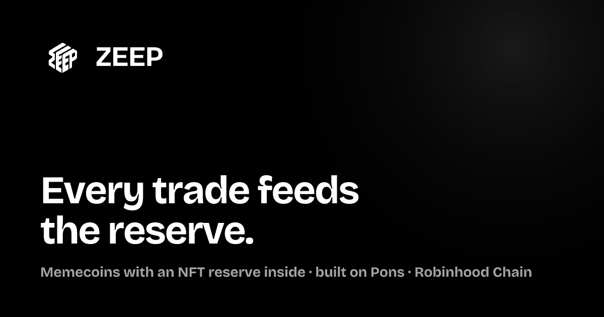

<p align="center">
  
</p>

<h1 align="center">ZEEP</h1>

<p align="center">
  <strong>Memecoins with a reserve inside.</strong><br />
  Launch a coin on Robinhood Chain, pair it with an NFT or graded-card collection, and let every trade build its reserve.
</p>

<p align="center">
  
  
  
  
  
  
</p>

---

## What is ZEEP?

ZEEP is a coin launcher on **Robinhood Chain**, built on **Pons V2**. Every coin launched through ZEEP is a regular Pons bonding-curve coin. What ZEEP adds on top is a **reserve**:

1. **Pick a collection** — any of 438 listed NFT collections across Robinhood Chain, Ethereum, Base, Solana and Hyperliquid, or graded Pokémon / One Piece cards (Courtyard, Collector Crypt).
2. **Pick a payout rule** — raffle the NFTs to holders, hold them, or burn them. The rule is locked at launch.
3. **Trade** — a share of every buy and sell is set aside for that collection's reserve, split **80% reserve / 20% treasury**.

ZEEP also hosts a **Gacha Station**: sealed Pokémon and One Piece packs from Collector Crypt on Solana, paid in USDC, each opening into a real graded card you can redeem physically.

## Features

| | |
|---|---|
| **4-step launch wizard** | Coin → collection → rules → review, with validation, image upload (IPFS via Pinata) and a clear fee breakdown. One transaction, no dev buy. |
| **Coin pages identical to Pons** | Market cap, price, bonding-curve progress, trades, holders and candles come straight from Pons, so every number matches ponsfamily.com. |
| **Live, not polled** | New trades land on the page within seconds via Pons' live trade feed — header, curve, trade table and chart update in place. |
| **Pro chart** | Logarithmic scale, 1m / 5m / 1h / 6h / All, candles or line, Pons' exact 24h rule, and creator markers: **D** for dev trades, **T** for dev token transfers. |
| **438 collections + cards** | Searchable, chain-filterable collection directory with real logos and contract addresses. |
| **Gacha Station** | Live Collector Crypt machines with odds, stock and expected value; sign with your own Solana wallet. |
| **Wallets** | Privy — browser wallets, email login with embedded wallets, and Solana for the Gacha Station. |
| **Polished UI** | Pure black-and-white design system, Bricolage Grotesque type, reduced-motion-aware animations, mobile / tablet / desktop layouts, share cards. |

## How the money flows

| Item | Value |
|---|---|
| Launch fee | 0.0005 ETH, paid to Pons (plus gas) |
| Trading fee | 1% of every buy and sell (Pons' curve fee; ~0.75% is paid to the coin's creator side) |
| Creator tax | 0–10%, chosen at launch |
| Earnings split | 80% to the coin's reserve · 20% to the ZEEP treasury |
| Supply | 1,000,000,000, fixed |
| Starting market cap | 1.68 ETH |
| Graduation | at 4.20 ETH raised, into a locked Pons pool |

## Status

ZEEP is shipped in phases, and the site says so wherever it matters.

- **Phase 1 — live.** Coins launch as real on-chain Pons coins, verified against the launch transaction before they're recorded. Market data on every coin page is live from Pons.
- **Phase 1.5 — live, simulated.** A scheduled keeper reads real Pons fee data for every coin, but reserve purchases and raffle draws are logged, not executed. Every reserve panel in this state is badged **Simulated**. Until the router below is deployed, Pons pays creator fees to the creator's own wallet.
- **Phase 2 — built and tested, not deployed.** The on-chain reserve system lives in [`contracts/`](contracts/): a one-transaction launcher plus a per-coin Vault, FeeRouter and Raffle (commit-reveal draws seeded from a future block hash, Seaport-1.6-only purchases, no withdraw path), and a cross-chain variant for collections outside Robinhood Chain. 32 Hardhat tests pass. **Not audited and not deployed.**

## Tech stack

- **App:** Next.js 15 (App Router), React 19, TypeScript, Tailwind CSS 3, Framer Motion
- **Web3:** ethers v6, Privy (EVM + Solana), lightweight-charts
- **Data:** Pons V2 (on-chain + Pons' launch API), Supabase (coin registry), Pinata (IPFS), Collector Crypt Gacha API
- **Contracts:** Solidity, Hardhat 3, Ignition
- **Hosting:** Vercel (with a daily keeper cron)

## Getting started

Requires Node.js 18.18 or newer.

```bash
git clone https://github.com/Mickiyugods/ZZ.git
cd ZZ
npm install
cp .env.example .env.local   # fill in what you have — everything is optional locally
npm run dev                   # http://localhost:3000
```

No keys are needed to run it locally: the coin registry falls back to a JSON file in `.data/`, wallet connect is simply disabled without a Privy app ID, and the Gacha Station defaults to Collector Crypt's devnet. For a production-like preview, run `npm run preview` (builds, then serves on port 3471).

### Environment variables

All of them are documented in [`.env.example`](.env.example).

| Variable | Needed for | |
|---|---|---|
| `SUPABASE_URL`, `SUPABASE_SERVICE_KEY` | Coin registry in production | Required live |
| `NEXT_PUBLIC_PRIVY_APP_ID` | Wallet connect | Required live |
| `RPC_URL` | Server-side Robinhood Chain RPC (Alchemy, with Robinhood Mainnet enabled) | Recommended |
| `CRON_SECRET` | Protects the keeper cron endpoint | Required live |
| `NEXT_PUBLIC_SITE_URL` | Absolute URLs for share cards | Required live |
| `COLLECTORCRYPT_GACHA_URL` | `https://gacha.collectorcrypt.com` for real packs (defaults to devnet) | Optional |
| `COLLECTORCRYPT_API_KEY` | Attributes Gacha packs to ZEEP (request it from Collector Crypt) | Optional |
| `PINATA_JWT` | Logo uploads in the launch wizard | Optional |
| `NEXT_PUBLIC_ZEEP_*` | ZEEP contract addresses, after the Phase 2 deploy | Later |

### Contracts

```bash
cd contracts
npm install
npx hardhat test
```

## Project structure

```
app/                 Pages (home, explore, launch, coin, gacha, cards, collections, docs, contracts, faq, profile)
app/api/             Route handlers — registry, Pons proxy, Gacha proxy, RPC gateway, keeper cron, uploads
components/          UI — sidebar, footer, coin card, price chart, wallet dialog
lib/                 Chain reads/writes, Pons client, formatting, config
lib/server/          Registry store, keeper, on-chain fallbacks, dev-only demo market
contracts/           Phase 2 Solidity system (Hardhat)
public/images/       Brand, chain logos, card photos, icons
```

## Disclaimer

Coins launched on ZEEP are experimental memecoins and can lose all value. Gacha pulls are random, and a card can be worth less than its pack. The Phase 2 contracts are unaudited. Nothing in this repository or on the site is financial advice.
